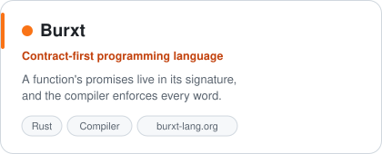
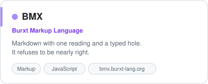
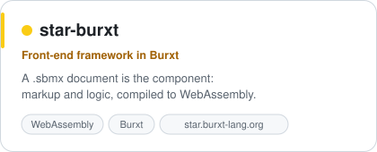
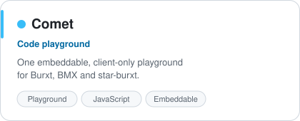
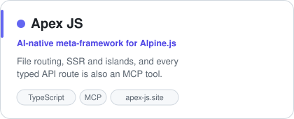
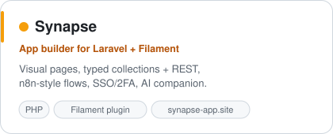
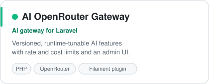

  <picture>
    <source media="(prefers-color-scheme: dark)" srcset="assets/hero-dark.svg">
    
  </picture>

  <a href="https://www.linkedin.com/in/andre-alarcon-corugda/"><b>LinkedIn</b></a> ·
  <a href="https://burxt-lang.org/"><b>burxt-lang.org</b></a> ·
  <a href="https://apex-js.site/"><b>apex-js.site</b></a> ·
  <a href="https://synapse-app.site/"><b>synapse-app.site</b></a>

I've spent 9+ years building the systems companies run on: CRMs, research platforms, partner portals, payroll and invoicing. Complex processes, complex data, many user roles. Seven of those years were the classic way; the last two, AI-native: I design **what the AI may touch, how a person checks its work, and how every feature becomes something an agent can safely call**.

Everything below is free and open source, giving back to the community that taught me.

## The Burxt stack

A programming language, and everything you need to build with it. Each layer is built on the one before.

  <picture>
    <source media="(prefers-color-scheme: dark)" srcset="assets/stack-dark.svg">
    
  </picture>

  <a href="https://github.com/andrecorugda/burxt"><picture><source media="(prefers-color-scheme: dark)" srcset="assets/card-burxt-dark.svg"></picture></a>
  <a href="https://github.com/andrecorugda/bmx"><picture><source media="(prefers-color-scheme: dark)" srcset="assets/card-bmx-dark.svg"></picture></a>
  <a href="https://github.com/andrecorugda/star-burxt"><picture><source media="(prefers-color-scheme: dark)" srcset="assets/card-star-burxt-dark.svg"></picture></a>
  <a href="https://github.com/andrecorugda/comet-code-playground"><picture><source media="(prefers-color-scheme: dark)" srcset="assets/card-comet-dark.svg"></picture></a>

## AI-native web · Laravel + Filament

  <a href="https://github.com/andrecorugda/apexjs"><picture><source media="(prefers-color-scheme: dark)" srcset="assets/card-apexjs-dark.svg"></picture></a>
  <a href="https://github.com/andrecorugda/synapse-app-builder"><picture><source media="(prefers-color-scheme: dark)" srcset="assets/card-synapse-dark.svg"></picture></a>
  <a href="https://github.com/andrecorugda/ai-openrouter-gateway"><picture><source media="(prefers-color-scheme: dark)" srcset="assets/card-ai-gateway-dark.svg"></picture></a>

Synapse and the AI Gateway are listed on the <a href="https://filamentphp.com/plugins/andre-corugda-synapse-app-builder">official Filament plugin directory</a>.

## Day job

**Senior Software Developer @ INS Global**: lead developer of the company's CRM platform (Laravel + React/TypeScript on Microsoft Azure), with CI/CD, a preview environment per pull request, a central AI gateway, and an MCP server that lets staff work with live company data from AI assistants under their own permissions. IT lead for ISO 27001.

Before: Cloud Employee (UK) · CHuGO (Singapore) · Evidera, Associate Manager, Development · Medimix International

## Recently shipped

<!-- activity:start -->
| Repository | Latest change | Date |
|---|---|---|
| [**burxt**](https://github.com/andrecorugda/burxt) | [Two assertions permitted a superset, and the superset is where the defect lives](https://github.com/andrecorugda/burxt/commit/263a6e7e84317b545f73bd25229ab61d05222cee) | 2026-08-21 |
| [**bmx**](https://github.com/andrecorugda/bmx) | [Two sentinels were chosen so that untouched fails, and only one of them for the…](https://github.com/andrecorugda/bmx/commit/1431a884a1e408da87f3c9b8a3e637b5971ad650) | 2026-08-21 |
| [**star-burxt**](https://github.com/andrecorugda/star-burxt) | [`18 pages, all wrapped` over a scan that could not see a delimiter](https://github.com/andrecorugda/star-burxt/commit/98bbfd3a79bd361e288c40588b27f29ac8c7a013) | 2026-08-21 |
| [**comet-code-playground**](https://github.com/andrecorugda/comet-code-playground) | [The console's stdout is asserted exactly, not merely contained](https://github.com/andrecorugda/comet-code-playground/commit/7779dee1683290247d9bcfae97ab0ba0d75b6d5c) | 2026-08-21 |
| [**apexjs**](https://github.com/andrecorugda/apexjs) | [chore(site): migrate domain apexjs.site → apex-js.site (CNAME, canonicals,…](https://github.com/andrecorugda/apexjs/commit/0da7a07248063b47c8b09422b180248ffccc1d4a) | 2026-08-10 |
| [**synapse-app-builder**](https://github.com/andrecorugda/synapse-app-builder) | [docs(changelog): stamp v1.4.0 (2026-07-13)](https://github.com/andrecorugda/synapse-app-builder/commit/76babfa39ed9a0f594f95c1933fabc49daf7eccf) | 2026-07-13 |
<!-- activity:end -->

Refreshed daily by a GitHub Action.

## Stack

   
  

  <picture>
    <source media="(prefers-color-scheme: dark)" srcset="assets/ai-dark.svg">
    
  </picture>

